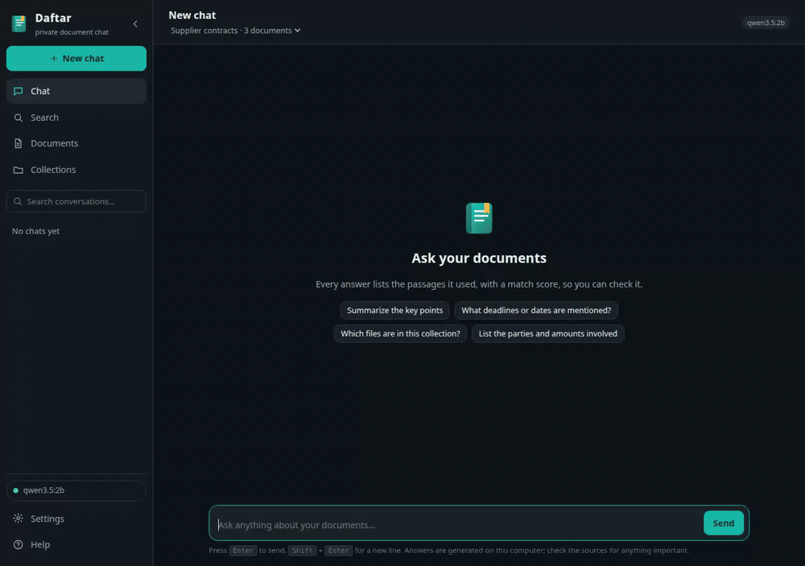
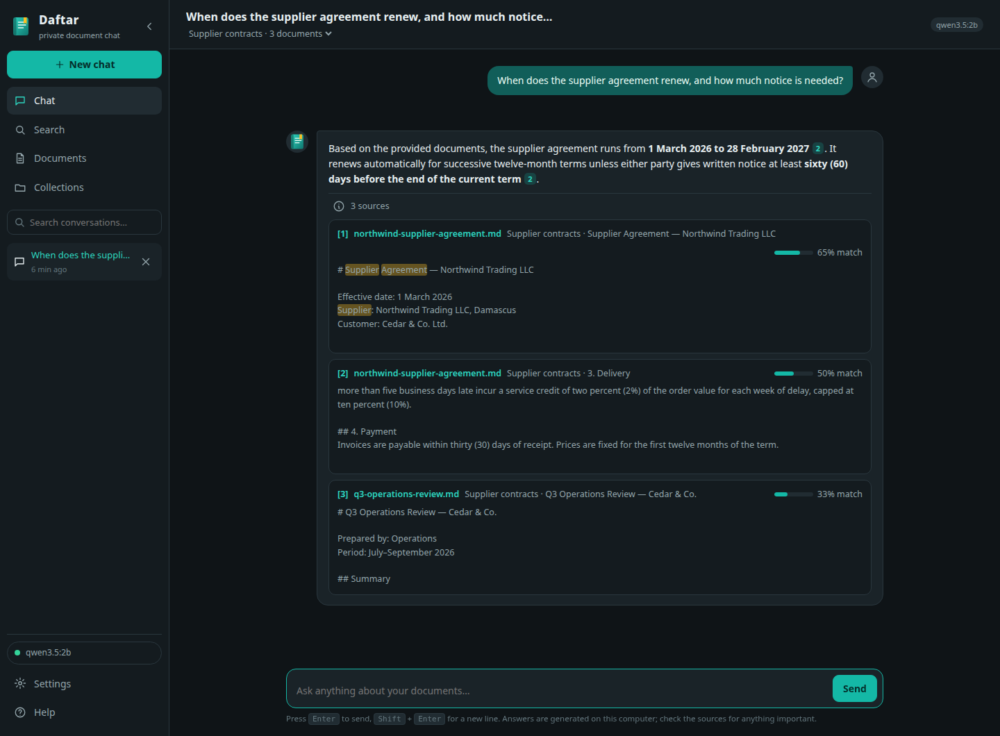
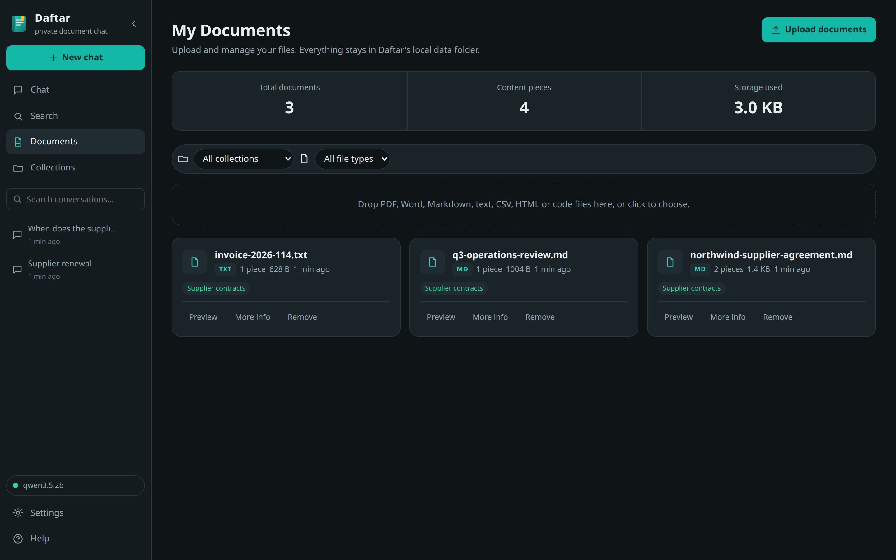
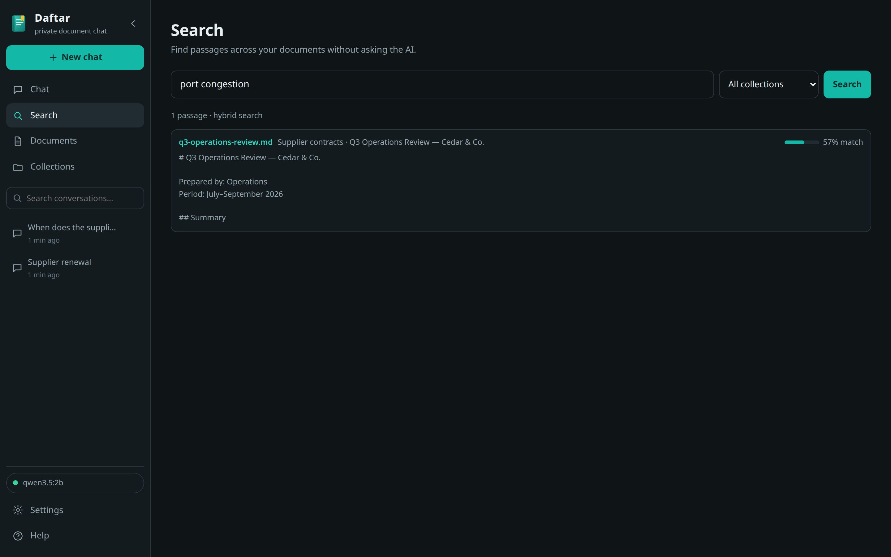
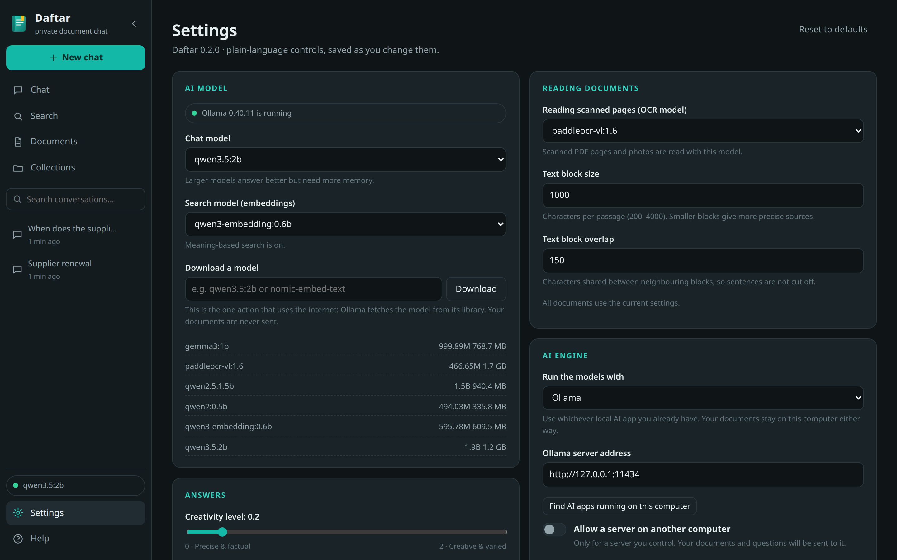
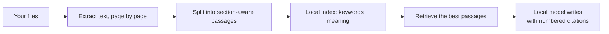

<p align="center">
  
</p>

<h1 align="center">Daftar</h1>

<p align="center">
  <b>Your documents. Your computer. Real answers.</b><br>
  Private document chat with citations. No cloud, no account, no telemetry.
</p>

<p align="center">
  <a href="LICENSE"></a>
  
  
  
  
</p>

[Live demo](#-see-it-live) · [🌱 Beginner guide](#-beginner-guide--read-this-and-you-are-a-professional) · [Features](#-what-you-can-do) · [How it works](#-how-it-works) · [Benchmarks](#-measured-performance) · [Quick start](#-quick-start-for-the-impatient) · [FAQ](#-faq)



**Daftar answers questions about your documents without ever sending them anywhere.** It is a small desktop application for contracts, reports, research papers and notes. Ask in plain language; it finds the exact passages on your disk, and a local AI model writes the answer with numbered citations and a match score. No account, no API key, no subscription, no upload.

**For a busy decision-maker:** every sentence in an answer points to the page it came from, so a lawyer, auditor or researcher can verify it in seconds. The files never leave the machine, so there is no data-processing agreement, no cloud review and no third-party copy of confidential material. It works offline on a normal laptop, and it is open source under the MIT licence with no per-seat fee.

It runs on Windows, macOS and Linux, reads Arabic alongside English, and offers two ways to run the model: **built-in llama.cpp** (nothing else to install) or **Ollama** (full features, including reading scanned pages).

---

## 🚀 See it live

The showcase site is in [`docs/`](docs/index.html) and is ready for GitHub Pages.

- **Try the demo:** [https://M0-AR.github.io/daftar/](https://M0-AR.github.io/daftar/)
- **Open the desktop app:** the “Open the full app” button uses a `daftar://` link. The first normal launch registers the handler for your user only; no administrator rights. If nothing opens, the page shows an install panel.
- **Play the 3D Knowledge Lab:** ten steps build a retrieval brain; drag to rotate, click the node that matches the definition.
- **Take the quiz:** ten questions with a short explanation after every answer.
- **Move the sliders:** a simple calculator shows how much document searching costs in time and money.
- **Read the numbers:** every benchmark on the site is measured, with its conditions written next to it.

Want to open the site from this folder without publishing? Open [`preview.html`](preview.html) in a browser. It is the same page with its asset paths pointed at `docs/`. The published site needs no build step and loads no third-party scripts, fonts or analytics.

> **Prefer your own copy?** Push your fork to GitHub, open **Settings → Pages**, choose **Deploy from a branch**, select **main** and **/docs**, and save. The `.nojekyll` file is already included. Full steps are in [Publish the showcase site](#-publish-the-showcase-site).

---

## 🌱 Beginner guide — read this and you are a professional

You do not need to know what a vector database, an embedding or a large language model is. You need a computer, about 2 GB of free disk space and twenty minutes. This guide starts at zero and explains every word it uses.

*Let's work this out in a step-by-step way to be sure we have the right answer.*

### What Daftar actually does

Imagine a very fast assistant sitting next to a filing cabinet.

1. You put documents in the cabinet.
2. You ask a question in ordinary language.
3. The assistant finds the few pages that probably contain the answer.
4. A second assistant — a local AI model — reads only those pages and writes a short answer.
5. The answer has small numbers like `[1]` and `[2]`. Click one and you see the exact sentence it came from.

Everything happens on your computer. Nothing is uploaded. That is the whole idea.

### Step 1 — Install Python

Daftar is written in Python. Python is free and already on many Macs and Linux machines.

- **Windows:** download Python 3.11 or newer from [python.org/downloads](https://www.python.org/downloads/). On the first installer screen, tick **“Add python.exe to PATH”** before clicking Install. Then open **PowerShell** and check:
  ```powershell
  python --version
  ```
- **macOS:** download the official installer from [python.org/downloads](https://www.python.org/downloads/) and run:
  ```bash
  python3 --version
  ```
- **Linux (Debian/Ubuntu):**
  ```bash
  sudo apt update
  sudo apt install python3 python3-venv python3-pip
  python3 --version
  ```

You want to see `Python 3.11` or higher. If you see an older version, install the newer one first.

> **What is a terminal?** On Windows it is PowerShell; on macOS it is Terminal; on Linux it is your normal terminal application. It is a window where you type commands instead of clicking buttons. Copy one line at a time, press Enter, and wait for the prompt to come back.

### Step 2 — Get the Daftar folder

If you have Git:

```bash
git clone https://github.com/M0-AR/daftar.git
cd daftar
```

No Git? Open the [repository page](https://github.com/M0-AR/daftar), click **Code → Download ZIP**, extract the folder, then open a terminal inside it.

> **What just happened?** You copied the program's source code — the readable recipe — onto your computer. No installation has happened yet.

### Step 3 — Give Daftar its own toolbox

A “virtual environment” is a private box of Python tools for one project. It keeps Daftar from interfering with anything else on your computer.

**Windows (PowerShell):**
```powershell
python -m venv .venv
.venv\Scripts\activate
pip install -e .
```

**macOS / Linux:**
```bash
python3 -m venv .venv
source .venv/bin/activate
pip install -e .
```

You will know it worked when your prompt starts with `(.venv)`. The `pip install -e .` line reads the project's shopping list and installs exactly what it needs.

Optional: for a native desktop window instead of a browser tab, install the desktop extra:

```bash
pip install -e ".[desktop]"
```

Without it, Daftar still works and opens in your normal browser.

### Step 4 — Give it a brain

A document assistant needs a language model — the part that writes sentences. You have two good choices. Pick one; you can change it later in **Settings → AI engine**.

**Choice A — Ollama (recommended for beginners, full features).** Install [Ollama](https://ollama.com), then pull a small chat model and a search model:

```bash
ollama pull qwen3.5:2b
ollama pull qwen3-embedding:0.6b
```

If you want Daftar to read scanned pages, also pull a vision model such as `paddleocr-vl:1.6` (or use any vision model you already have). Ollama stays on your computer too; it is not a cloud service.

**Choice B — built-in llama.cpp (no extra app, chat only).** Daftar can run a GGUF chat model by itself. Download `llama-server` from the [llama.cpp releases](https://github.com/ggml-org/llama.cpp/releases) and a `.gguf` chat model of your choice, then place them anywhere under `~/models` — for example `~/models/llama.cpp/` and `~/models/qwen3.5-2b-gguf/`. Daftar finds them automatically, or you can enter exact paths in **Settings → AI engine**. The built-in engine does chat only: search uses exact words, and scans are reported as unreadable.

Not sure? Start with Choice A, then try Choice B later. The app's setup checklist also offers a one-click model download when nothing is installed yet.

> **What is a model?** A large file of numbers that has learned patterns from text. A 2-billion-parameter model is a few gigabytes and runs on a normal laptop. Bigger models write better prose but need more memory and time.

### Step 5 — Start it

```bash
daftar
```

A window opens — or a browser tab, if you skipped the desktop extra. To start only the server and open a browser tab:

```bash
daftar --browser
```

The server listens on `http://127.0.0.1:8765` by default. If that port is busy, Daftar picks a free one and prints the address. For a headless server, run `daftar --headless` and open the printed address.

The first launch also registers a `daftar://` link handler for your user, so the “Open the full app” and “Open in browser” buttons on the website can start Daftar. This is per-user, needs no administrator rights, and does not change your default browser. If you move the project, start it once with `daftar --register-protocol` to refresh the link. On macOS, the link is registered by the built `.app` bundle; a source run can still use the browser.

> **What is `127.0.0.1`?** It means “this computer”. The server is not reachable from the internet; it only listens on your own machine.

### Step 6 — Make your first collection

A **collection** is a folder-like group with its own search index: one per client, project or case. Click **+ New collection**, name it something obvious like `Supplier contracts`, then drag two or three documents into it. Daftar accepts PDF, Word, Markdown, text, CSV, HTML, notebooks and many code files.

Wait until the readiness indicator reaches 100%. For a few pages this takes seconds.

### Step 7 — Ask a question you can check

Pick a document you already know well. Ask something whose answer you can verify by eye, for example:

- “When does this agreement renew, and how much notice is required?”
- “What is the total on invoice 2026-114?”
- “Which risks does the Q3 review mention?”

Read the answer, then click the citation. Daftar shows the source passage, its file name, its section and a **match score**. The score compares the question with the passage; it is not a probability that the answer is true. Treat it as a hint, then read the source — exactly as you would with a colleague's summary.

### Step 8 — Know where your data lives

Daftar keeps its index, extracted text, chats and settings in one folder:

| System | Folder |
|---|---|
| Linux | `~/.local/share/daftar` |
| macOS | `~/Library/Application Support/Daftar` |
| Windows | `%APPDATA%\Daftar` |

Set `DAFTAR_HOME` before starting the app to use a different folder. Delete it to erase everything. Your original documents stay wherever you keep them.

Daftar can save the whole library — documents, originals, chats and the search index — as one verified `.daftar` file. Use **Settings → Backup & portability** to export a copy, import one, or restore an earlier backup. While the app runs it also makes at most one automatic backup a day, keeps the last 7 daily and 4 weekly copies, and makes a safety backup before every import or restore. The default backup folder is `<data folder>/backups`; you can choose another folder in Settings.

### Step 9 — If something goes wrong

| Symptom | Likely cause and fix |
|---|---|
| `python: command not found` | Use `python3` on macOS/Linux. On Windows, reinstall Python with “Add to PATH” ticked. |
| `No module named daftar` | The virtual environment is not active, or `pip install -e .` was skipped. Activate it and run the install again. |
| Chat says no model is installed | Open **Settings → Download a model**, or install Ollama and pull a model. For the built-in engine, check that the GGUF path is correct. |
| A scanned PDF has no text | The built-in engine cannot read images. Switch to Ollama with a vision model. |
| Answers feel slow | Use a smaller model (2B), close memory-hungry apps, or use a computer with a GPU. |
| The browser did not open | Run `daftar --browser`, or `daftar --headless --port 8765` and open the printed address. |
| The website's “Open the full app” button does nothing | Allow the browser's external-protocol prompt. If you moved the project, run `daftar --register-protocol`. On macOS, use the built `.app`; source runs do not register the link. |

### Step 10 — Uninstall or start over

Close Daftar, delete the data folder from Step 8, then delete the project folder. On Linux and Windows, one small per-user link handler remains so the website button can find the app; remove it with `rm ~/.local/share/applications/daftar.desktop` on Linux or `reg delete "HKCU\Software\Classes\daftar" /f` on Windows. There is no service, no account and no cloud copy. Original documents are untouched.

### Words you will hear, in plain language

| Word | What it means here |
|---|---|
| **Collection** | A group of documents with its own index — like a folder with a brain. |
| **Passage (or chunk)** | A short piece of a document, usually about a page section. Small pieces make precise citations possible. |
| **Embedding** | A list of numbers that represents meaning, so “renewal” can match “term extension” even without the same word. |
| **Keyword index** | A dictionary of exact words and codes. It never loses a contract number or a date. |
| **Hybrid search** | Using meaning and exact words together, then combining the scores. |
| **Retrieval** | Finding the passages that probably contain the answer. |
| **Citation** | The number in the answer that links to the source passage. |
| **Match score** | A relevance hint for a retrieved passage, not a truth probability. |
| **OCR** | Optical character recognition: turning a picture of text into editable text. |
| **Local model** | An AI model running on your own computer instead of a company's server. |
| **GGUF** | A file format for models that run with llama.cpp. |
| **RAG** | Retrieval-augmented generation: find passages first, then ask the model to answer from them. |

That is the whole beginner's path. If you can follow a recipe, you can run Daftar.

---

## ⚡ Quick start for the impatient

Requires **Python 3.11+**. About 2 GB of free disk for a small model.

```bash
git clone https://github.com/M0-AR/daftar.git
cd daftar
python3 -m venv .venv && source .venv/bin/activate   # Windows: .venv\Scripts\activate
pip install -e .
daftar
```

With Ollama (chat + semantic search + scanned pages):

```bash
ollama pull qwen3.5:2b
ollama pull qwen3-embedding:0.6b
ollama pull paddleocr-vl:1.6   # optional, for scans
```

Choose the engine in **Settings → AI engine**. With the built-in engine, place `llama-server` and a `.gguf` chat model under `~/models`, or set explicit paths in the same screen.

---

## ✨ What you can do

- **Collections** — separate knowledge bases for separate clients or cases. One file can live in several collections, each with its own index. Readiness percentage, status check and one-click **Optimize search**.
- **Documents** — PDF, Word, Markdown, plain text, CSV, HTML, Jupyter notebooks and 40+ code formats. Drag and drop, filter by collection or type, preview with word count and reading time.
- **Chat with evidence** — one collection or all of them. Streamed answers, numbered citations, sources with section and match score, and controls to edit, copy, regenerate or delete messages.
- **Search without the model** — find passages directly when you want the source, not a summary.
- **Find old conversations** — search across every chat, rename them, keep them on your machine.
- **Plain-language settings** — creativity, passages to use, passages to scan, block size and overlap, “improve answer relevance”, model picker and download, server address, dark/light theme, debug logs, reset to defaults.
- **Two engines, one interface** — built-in llama.cpp for chat with no extra install, or Ollama for chat, embeddings and vision OCR. OpenAI-compatible servers (LM Studio, Jan, vLLM, LocalAI, KoboldCpp) are available as an explicit opt-in.
- **Arabic and mixed text** — Arabic is normalised for search, Arabic documents are indexed, and questions can be asked in Arabic. The interface is in English.
- **Export** — take an answer or a document out as PDF, DOCX, Markdown, text or HTML.
- **Backup and move** — export the whole library as one verified `.daftar` file, import it on another computer, or restore an automatic daily backup. A safety backup is made before any restore.
- **Private by design** — loopback only, Host header checks, a custom header required for writes, cross-origin preflights blocked, no telemetry, no external assets.

---

## 🖼️ Screenshots

The chat is the centre of the app: the answer cites numbered passages, and every source shows its file, section and match score.



| Documents | Search |
|---|---|
|  |  |

Settings are written in plain language, not configuration jargon.



---

## 🧠 How it works

The model never “remembers” your documents. It reads the passages Daftar hands it. That single design choice is why the app can be small, private and auditable.



1. **Read** (`ingest.py`) — text per page for PDFs and per file for everything else; cached once per document. Scans go through OCR when a vision provider is configured.
2. **Split** (`store.py`) — overlapping passages of roughly 1,000 characters, with section context attached.
3. **Index** (`store.py`) — per collection, an SQLite FTS5 keyword index plus normalised embeddings. Names, codes and dates survive in the keyword half.
4. **Retrieve** (`rag.py`) — keyword (BM25, prefix-matched) and vector candidates are scored as `0.7 × similarity + 0.3 × keyword coverage`; weak and duplicate matches are dropped before the model sees anything.
5. **Answer** (`server.py`) — the passages and the collection's file list go to the chat model with instructions to cite `[n]` and never invent facts. Tokens stream to the interface.

Data folder: `~/.local/share/daftar` on Linux, `~/Library/Application Support/Daftar` on macOS, `%APPDATA%\Daftar` on Windows; override with `DAFTAR_HOME`.

---

## ⚙️ Engines and models

| | Built-in llama.cpp | Ollama | OpenAI-compatible |
|---|---|---|---|
| **Chat** | Yes — any GGUF chat model | Yes | Yes |
| **Search by meaning** | No — keyword search (FTS5) | Yes | Depends on the server |
| **Scanned PDFs (OCR)** | No | Yes, with a vision model | Depends on the server |
| **Extra software** | Just `llama-server` + a GGUF | Ollama | The server application |
| **Network** | Never | Never after installation | Only the address you configure |

| Job | Default | If it is missing |
|---|---|---|
| Chat | `qwen3.5:2b` | The largest installed chat model |
| Search (embeddings) | `qwen3-embedding:0.6b` | Any embedding model, otherwise keyword search |
| Reading scans (OCR) | `paddleocr-vl:1.6` | Any vision model, otherwise scans are reported as unreadable |

Recommended models are small enough for a normal laptop. Most are Apache-2.0; check each model card before redistribution.

Reasoning models such as Qwen3.5 think before answering by default; Daftar turns that off for speed. Re-enable it in **Settings → Answers → Let the model reason first**. With Ollama, Qwen3.5 needs a recent version (0.40+); if it is not installed, Daftar falls back to the largest chat model you have. With no chat model at all, the app shows a setup checklist sized to your computer's memory, with a one-click download (Ollama) or a detected GGUF file, and a smoke test.

To add a GGUF model to Ollama:

```bash
printf 'FROM ./Qwen3.5-2B-Q4_K_M.gguf\nRENDERER qwen3.5\nPARSER qwen3.5\n' > Modelfile
ollama create qwen3.5:2b -f Modelfile

printf 'FROM ./Qwen3-Embedding-0.6B-Q8_0.gguf\n' > Modelfile
ollama create qwen3-embedding:0.6b -f Modelfile
```

Then **Collections → Check status → Optimize search** to add semantic search to documents that were indexed before.

---

## 📊 Measured performance

These are development-machine measurements, not a leaderboard claim. The evaluation scripts and questions live in `scripts/`, so you can rerun them on your hardware and with your documents.

| What was measured | Result | Conditions |
|---|---|---|
| Answer correctness | **25 / 27** (93%) | Qwen3.5-2B · 27-question evaluation set |
| Answers with a citation | **26 / 27** (96%) | Same run · citation must point to a real passage |
| Strong prompt injections hijacked | **0 / 8** | gemma3:1b · attacks embedded in documents |
| Retrieval recall@4 | **1.000** | 1,000-character blocks · English + Arabic set |
| Structure-aware retrieval | **1.000** recall@4 | Section-aware chunking · naive baseline 0.700 |
| Warm answer latency | **0.3 s** | RTX 3090 · gemma3:1b · 368 tokens/s · cold start 9.4 s |
| OCR on CPU | **23 s / page** | PaddleOCR-VL 1.6 · 1.9 GB RAM · English + Arabic lines |
| Automated tests | **128 offline + 3 live** | All passing · live tests need a local model |

Latency depends on your hardware. A 2B model on a modern laptop is slower than the RTX figure and still usable; a GPU makes it feel instant. OCR speed depends on page complexity. The retrieval numbers come from a fixed evaluation set, not a claim about every document. Read the [research notes](docs/RESEARCH.md) for methods and sources.

Reproduce the main ones:

```bash
.venv/bin/python scripts/eval_answers.py
.venv/bin/python scripts/eval_retrieval.py
.venv/bin/python scripts/eval_injection_strong.py
```

---

## 🔒 Privacy and security

- **Loopback only.** The server binds to `127.0.0.1`, validates the `Host` header and rejects other host names.
- **Write protection.** State-changing requests require a custom header, which blocks ordinary cross-site form posts. Cross-origin preflights are refused.
- **Random engine key.** The built-in llama.cpp child process can run with a random API key, so other local programs cannot silently use it.
- **No telemetry, no third-party assets.** No analytics, no crash reporting, no remote fonts or scripts. The app works with the network cable unplugged.
- **Remote is opt-in.** A non-local Ollama address or an OpenAI-compatible server must be configured explicitly; nothing is sent anywhere by default.
- **Everything in one folder.** Documents' extracted text, the index, chats and settings live in the data folder. Delete it and everything is gone.

**Honest threat model:** “local” means your documents are not sent to a cloud service. It does not protect against malware, a compromised operating-system account, or someone who can read your disk. Use full-disk encryption and normal access controls for that layer.

---

## 👥 Who it is for

- **Legal and compliance** — ask a contract about renewal, liability or notice periods and get the clause, not a paraphrase.
- **Finance and operations** — reconcile invoices, find why a target was missed, and keep the source line in view.
- **Healthcare and research** — work through notes and papers on a machine you control, without a data-processing agreement.
- **Government and NGOs** — keep citizen, grant and case files inside the organisation, including offline at a field office.
- **Agencies and consultants** — keep each client in a separate collection on your own laptop, with no shared cloud tenant.
- **Solo professionals** — one install, no subscription and no per-seat API bill, on a normal laptop.

---

## 💼 Why it matters

A cloud chatbot asked about a private contract has to send the contract to someone else's computer. Daftar sends nothing. It finds the relevant pages on your disk and asks a model on your disk to read them, so the useful answer and the confidential file can finally coexist.

For a team, that changes three practical things:

1. **No new data processor.** There is no cloud account, no data-processing agreement and no vendor review for the documents themselves.
2. **No per-seat meter.** MIT licence, local models, no token bill. The marginal cost of a new colleague is zero.
3. **An audit trail by default.** Every claim carries a citation. Reviewers check the source instead of trusting the prose.

The showcase site includes an illustrative ROI calculator for search time. Treat it as a conversation starter, not a promise: it counts search time only and excludes setup, review and the value of better decisions.

---

## 🧱 Build a standalone app

On each target operating system:

```bash
python scripts/build.py
python scripts/smoke_build.py
```

The result is `dist/Daftar/`. If `vendor/llama.cpp/` exists — the `llama-server` program and its libraries — it is bundled automatically; otherwise the packaged app uses Ollama or another local AI app. Check the bundle with:

```bash
dist/Daftar/Daftar --self-test
```

The repository includes `.github/workflows/build.yml`, which builds and smoke-tests Windows, macOS and Linux on GitHub Actions. Builds must be produced on their target OS; they are not cross-compiled.

---

## ✅ Test

```bash
pip install -e ".[dev]"
.venv/bin/python -m pytest            # offline suite with a fake engine
.venv/bin/python -m pytest -m live    # built-in llama.cpp smoke test + end-to-end against Ollama
```

The offline suite needs no model and no network. The live suite needs a local model and is skipped otherwise. Current result: **128 offline + 3 live, all passing**.

---

## 🌐 Publish the showcase site

The site is the [`docs/`](docs/index.html) folder: hand-written HTML, CSS and JavaScript with no build step and no third-party assets. To serve it with GitHub Pages:

1. Push the repository to GitHub.
2. Open the repository's **Settings → Pages**.
3. Under **Build and deployment**, choose **Deploy from a branch**.
4. Select branch **main** and folder **/docs**, then **Save**.
5. Wait for the deployment, then open `https://M0-AR.github.io/daftar/`.

The `docs/.nojekyll` file tells Pages to serve the folder as-is. The root `preview.html` is only for local preview; Pages serves `docs/index.html` and the three technical notes as styled HTML pages (`gap.html`, `research.html`, `distribution.html`). The Markdown originals stay in the repository and render on GitHub.

---

## ❓ FAQ

**Does it need the internet?**
Only to download the app and a model the first time. After that, the app, the index and the model work offline. The interface loads no remote fonts, scripts or images.

**Do I need a GPU?**
No. A 2-billion-parameter model runs on a normal CPU and is fine for document questions. A GPU makes answers much faster; the warm-latency figure above was measured on an RTX 3090.

**Is my data really private?**
Yes, in the sense that matters: documents are read and indexed on your computer, and the model runs on your computer. Daftar creates no account, sends no telemetry and calls no cloud API unless you explicitly configure a remote engine. The honest limit is in the threat model above.

**Does it work with Arabic?**
Yes. Arabic text is normalised for search, Arabic documents are indexed, and you can ask questions in Arabic. The interface is in English. Mixed Arabic/English documents work, and the invoice in the demo includes an Arabic note you can ask about.

**How is this different from a cloud chatbot?**
A cloud chatbot is a general assistant that may or may not have your documents. Daftar is a retrieval system first: it finds the exact passages in your files, then a local model writes from them. The difference is privacy plus verifiability.

**What does the match score mean?**
It is a relevance indicator for a retrieved passage, not a probability that the answer is true. Use it to compare sources, then read the citation.

**Can I use my own model?**
Yes. Add any GGUF chat model to the built-in engine, or point Daftar at Ollama or an OpenAI-compatible server. Embeddings and OCR need a provider that supports them; the app names the missing capability instead of failing silently.

**Can I delete everything?**
Yes. Delete a collection or document in the interface, or remove the data folder from Step 8 to erase the index, extracted text, chat history and settings. Original files you added from elsewhere are not touched.

**Is it free? Can I use it at work?**
Daftar is open source under the MIT licence. You can use it commercially, modify it and redistribute it, provided you keep the copyright notice. There is no per-seat fee and no token bill.

**Why is the built-in engine chat-only?**
It is deliberately small: one process, chat only, no extra install. Embeddings and vision OCR need additional model files, so they are handled through Ollama or another compatible provider. The app reports the exact gap rather than degrading quietly.

---

## 🚧 Current limits and roadmap

Honest limits of this build:

- The built-in llama.cpp engine does **chat only**: keyword search, no embeddings, no OCR.
- Scanned pages need a vision-capable provider (today: Ollama or another compatible server).
- Reranking is a heuristic threshold, not a learned reranker.
- The evaluation sets are small (27 questions, 8 strong injections); treat the numbers as directional and rerun them on your documents.
- Windows and macOS packages must be built and signed on those systems. A workflow is provided; binaries are not code-signed.
- The interface is English; document content and questions can be Arabic.
- There is no mobile app and no multi-user server mode.

Roadmap, roughly in order: a learned reranker, first-run OCR wiring for the built-in engine, signed installers, and broader multilingual interface strings.

---

## 🗂️ Project layout

```
daftar/
├── daftar/                  application code
│   ├── app.py               window / browser launcher
│   ├── server.py            local HTTP API and static interface
│   ├── ingest.py            PDF, Office, text and scan reading
│   ├── store.py             SQLite index: FTS5 + embeddings
│   ├── library.py           one-file export, import, backup and restore
│   ├── rag.py               retrieval, scoring and citations
│   ├── llama_server.py      built-in llama.cpp engine
│   ├── ollama.py            Ollama engine
│   ├── openai_compat.py     OpenAI-compatible engine
│   └── static/              HTML, CSS, JavaScript interface
├── docs/                    showcase site, published by GitHub Pages
├── scripts/                 build, smoke test and evaluation scripts
├── tests/                   offline and live test suites
├── vendor/llama.cpp/        optional, bundled into a standalone build
├── pyproject.toml
└── LICENSE
```

---

## 🤝 Contributing

Open an issue before a large change, keep pull requests focused, and run the offline suite before sending one:

```bash
.venv/bin/python -m pytest
```

Match the existing style, avoid new dependencies unless they earn their place, and keep the privacy promise: no telemetry, no hidden network calls, no third-party assets in the interface. Feature gaps that this build was verified against are listed in [`docs/GAP.md`](docs/GAP.md).

---

## 📄 License

MIT — see [LICENSE](LICENSE). Copyright (c) 2026 Daftar contributors.

You may use Daftar commercially, modify it and redistribute it, provided the copyright notice and permission notice are kept.

---

<p align="center">
  <sub>Daftar (دفتر) means notebook. Built with respect for your documents.</sub><br>
  <sub>If Daftar saves you an afternoon, a star helps the next person find it.</sub>
</p>
